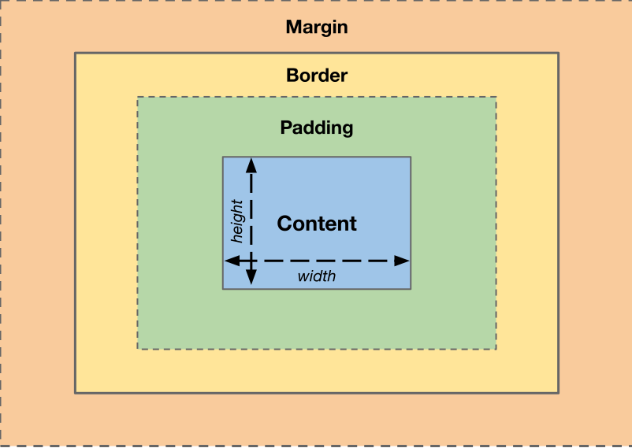
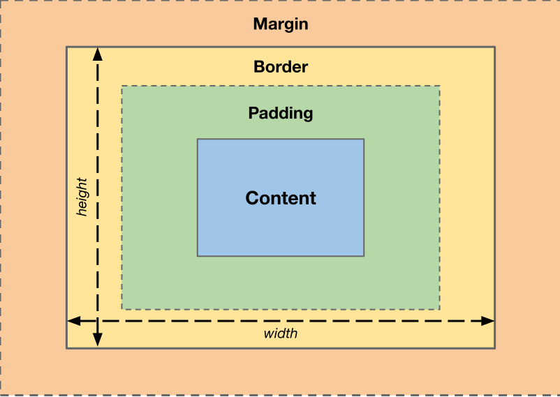

# Box-modellen

Ett viktigt koncept som används vid styling av webbsidor är box-modellen. Namnet kommer av att alla element i sig är rektanglar, boxar. Alla element har sina mått, det vill säga `width` och `height` som kan beräknas på olika sätt beroende på vilka delar av elementet som räknas in i måtten, dvs vilken box-modell som används. Förutom själva innehållet har alla element två typer av mellanrum: interna (`padding`) och externa (`margin`).

- `padding` är mellanrummet mellan elementets gräns och dess inre innehåll.
- `margin` är mellanrummet mellan elementets gräns och annat innehåll på sidan.

Du kanske undrar vad som menas med gränsen här. I det här fallet menas elementets `border`. Den kan också ta plats. Tjockleken på kantlinjen kan alltså påverka elementets mått. Tillsammans bildar dessa egenskaper en boxmodell för ett element. I CSS kan man sätta `box-sizing` till antingen `content-box` (standardvärdet) eller `border-box`. Detta är de egenskaperna som påverkar hur elementets mått beräknas och är därför viktigt att tänka på när man positionerar olika element. Se följande illustrationer:

---

## `box-sizing: content-box`

På bilden ser du att `border` och `padding` inte inkluderas i `width` och `height` när `box-sizing` har värdet `content-box`. Detta är standardbeteendet. Med `content-box` anger `width` och `height` storleken på själva innehållet. `padding` och `border` läggs sedan till utanför dessa mått, vilket gör att elementet totalt sett blir större.

---

## `box-sizing: border-box`

Vill man att `padding` och `border` ska räknas in i elementets `width` och `height` kan man lägga till `box-sizing: border-box;`. Då omfattar de angivna måtten innehållet, det interna mellanrummet (`padding`) och kantlinjen (`border`). Det externa mellanrummet (`margin`) räknas däremot inte in, utan ligger fortfarande utanför elementets mått.
