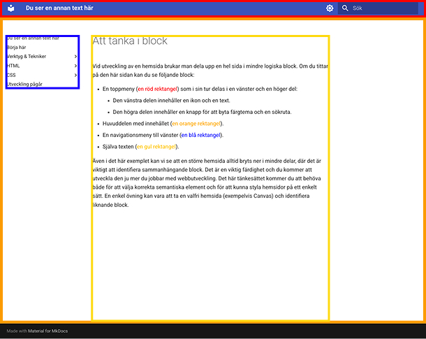

# Att tänka i block

Vid utveckling av en hemsida brukar man dela upp en hel sida i mindre logiska block. Om du tittar på den här sidan kan du se följande block:

- En toppmeny (::red | en röd rektangel::) som i sin tur delas i en vänster och en höger del:
    - Den vänstra delen innehåller en ikon och en text.
    - Den högra delen innehåller en knapp för att byta färgtema och en sökruta.
- Huvuddelen med innehållet (::orange | en orange rektangel::).
- En navigationsmeny till vänster (::blue | en blå rektangel::).
- Själva texten (::#FFC000 | en gul rektangel::).

Även i det här exemplet kan vi se att en större hemsida alltid bryts ner i mindre delar, där det är viktigt att identifiera sammanhängande block. Det är en viktig färdighet och du kommer att utveckla den ju mer du jobbar med webbutveckling. Det här tänkesättet kommer du att behöva både för att välja korrekta semantiska element och för att kunna styla hemsidor på ett enkelt sätt. En enkel övning kan vara att ta en valfri hemsida (exempelvis Canvas) och identifiera liknande block.