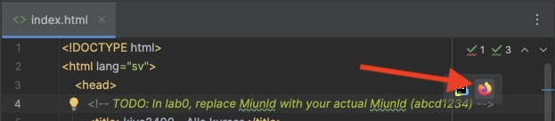
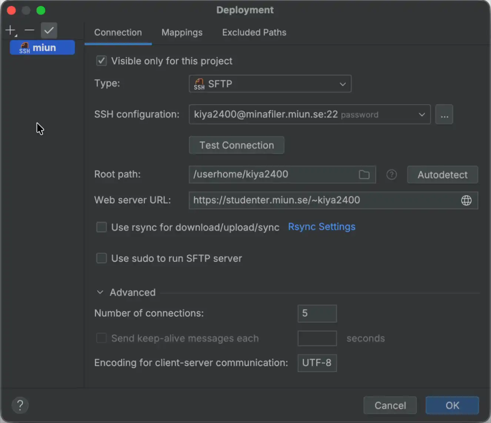
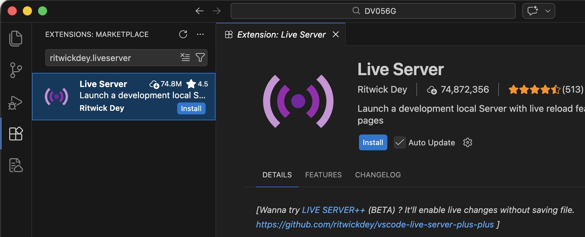
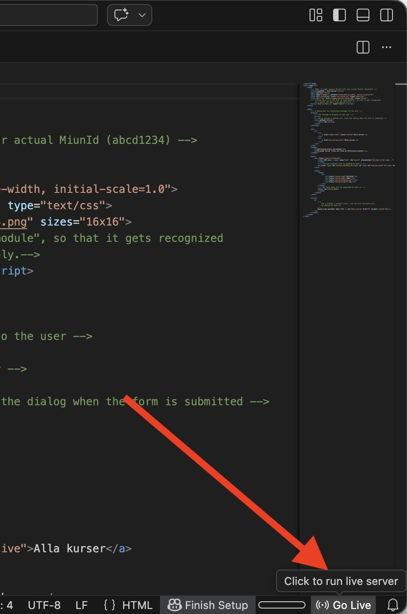

# Utvecklingsmiljö

En stor fördel med webbutveckling är att man inte behöver några speciella utvecklingsmiljöer, utan det räcker med att ha en terminal, en valfri texteditor och en webbläsare. De kanske mest populära alternativen för codeeditor är **WebStorm** och **VSCode**. Båda är bra och fungerar utmärkt för frontend-webbutveckling. Personligen rekommenderar jag **WebStorm**, eftersom det har mycket inbyggd funktionalitet.

---

## Installera utvecklingsmiljö

- [WebStorm, direktlänk](https://www.jetbrains.com/webstorm/download)
- [JetBrains Toolbox](https://www.jetbrains.com/toolbox-app/) rekommenderas om du använder andra JetBrains-IDE:er.
- [VSCode](https://code.visualstudio.com/download)

---

## Förhandsgranskning i realtid

^^^^WebStorm
WebStorm har inbyggd funktionalitet för att starta en lokal webbserver. Det är ett smidigt sätt att snabbt testa och förhandsgranska din webbapplikation i webbläsaren medan du utvecklar den utan att behöva ladda upp filer till en server.

När du öppnar en HTML-fil i WebStorm kommer du att se webbläsarikonerna. Klicka på en av dem för att starta en webbserver.

!!!!warning
Om du har konfigurerat deployment kommer WebStorm att försöka öppna den publicerade versionen istället för den lokala. För att fixa detta behöver du avmarkera dina deployments från standard:

!!!!
^^^^

^^^^VSCode
Tillägget **Live Server** gör det möjligt att starta en lokal webbserver direkt från Visual Studio Code. Det är ett smidigt sätt att snabbt testa och förhandsgranska din webbapplikation i webbläsaren medan du utvecklar den, utan att behöva ladda upp filer till en server.

Du installerar tillägget genom att söka efter: `ritwickdey.liveserver`.

När du har installerat tillägget kommer en ny knapp, **Go Live**, att dyka upp i Status Bar. Öppna en HTML-fil och klicka på den knappen för att starta Live Server.

^^^^

---

## Webbläsare

Oftast spelar det inte så stor roll vilken webbläsare du använder när du lär dig. När man kommer djupare in i ämnet ser man fler skillnader mellan olika webbläsare, eftersom varje webbläsare kan ha egna standardinställningar för olika delar av det man jobbar med inom frontend. Till att börja med kan du ha två webbläsare som du kan använda för att testa din kod: en som är chromium-baserad och en som är firefox-baserad. Detta ger dig möjlighet att testa mot två av de största webbläsarmotorerna och gör att du kan känna dig ganska säker på att sidan fungerar i många webbläsare.

^^^^Chromium- och Firefox-baserade webbläsare
### Chromium

- Google Chrome
- Microsoft Edge
- Arc
- Brave
- Opera

### Firefox

- Mozilla Firefox
- Zen
- LibreWolf
- Waterfox
^^^^

